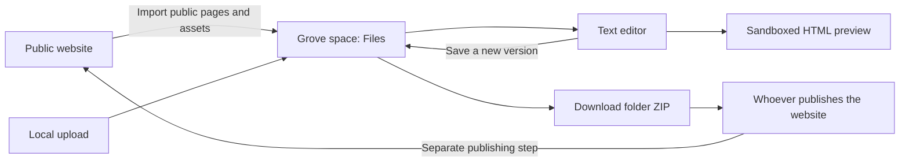
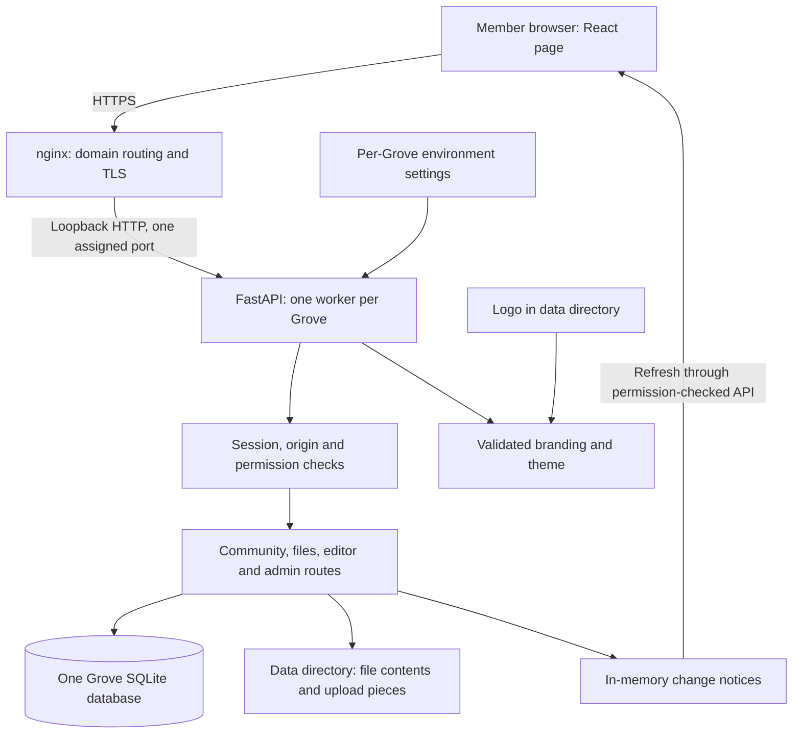
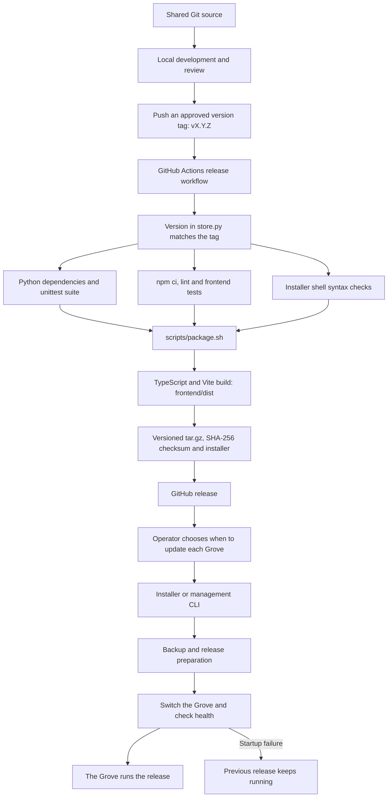
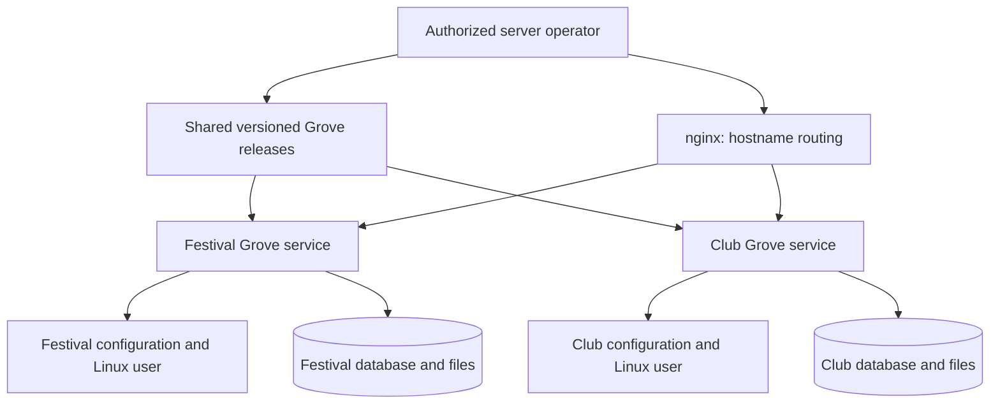

# Arynwood Grove manual

A guide for members, Grove owners and the people who operate their servers.
This manual describes version **0.5.2**. A server running an older release may
lack some of what is described here: `sudo arynwood-grove status` shows the
version a Grove runs.

## Find your way

- [Using your Grove](#using-your-grove)
- [Accounts, roles and privacy](#accounts-roles-and-privacy)
- [Files, editing and websites](#files-editing-and-websites)
- [How the software fits together](#how-the-software-fits-together)
- [Build and release diagram](#build-and-release-diagram)
- [One product, separate Groves](#one-product-separate-groves)
- [Server operation](#server-operation)
- [Troubleshooting](#troubleshooting)

## Using your Grove

Open your organization's Grove address and sign in. An account belongs to that
Grove: signing into one Grove does not sign you into any other.
Use an invitation from a space owner to join their space. Keep invitation links
private unless the owner deliberately creates a public invitation. An ordinary
invitation admits one person and expires after seven days; a space owner can
replace a public invite link or turn it off.

The first account is the host, created using the installer's private setup link.
The server operator can show that link again with `sudo arynwood-grove setup-link`.
Once an account exists, the command reports that the Grove already has a host.
Do not put setup links or recovery codes in shared documentation.

Choose a **Space** in the header. Spaces separate groups and their shared work
inside one Grove; they are not separate Groves.

| Page | What to do there |
|---|---|
| Calendar | Plan the day and add or review events. **Month overview** shows the wider view. |
| Overview | See upcoming plans, open tasks and recent activity in the selected space. |
| Board | Share posts and replies. |
| Space discussion | Talk with other people in the space. |
| Tasks | Track assignments and due dates. |
| Lists | Keep shared lists. |
| Notes | Keep shared notes or choose private visibility for your own notes. |
| Files | Upload, organize, download and edit the space's files. |
| People & identity | Manage your identity and the selected space; space owners also manage invitations and membership. |
| Grove admin | Owners and managers review people, spaces, storage, activity and wishes. |
| Webmaster tools | Owners and managers bring website files into a space for editing and handoff. |

Changes normally appear on other members' pages within about a second. If the
live connection drops, the page polls for changes until it reconnects. The wish
lamp sends a suggestion to the Grove's owners and managers, who see it in Grove
admin. It is also emailed to `GROVE_WISH_EMAIL` when that is set and the server
can send mail.

To recover a forgotten password, ask the server operator for a recovery code.
Enter it under **Forgot password?** Codes last 15 minutes; there is no automatic
password-reset email.

## Accounts, roles and privacy

There are three different kinds of authority. They should not be confused.

| Scope | Authority |
|---|---|
| Server operator | Controls Linux, installation, domains, releases, configuration and backups. Root can technically read server files and databases; application privacy is not a barrier to root. |
| Grove-wide roles | The host is always an owner. Owners assign owner, manager or member roles and change Grove settings. Owners and managers can open Grove admin. |
| Space roles | A space owner manages that space, its invitations and membership. Space membership controls ordinary access to its content. This role is separate from the Grove-wide role. |

Grove admin provides visibility across the Grove; it is not an infrastructure
control panel. Managers see everything in Grove admin but cannot change roles
or settings. Whether members can start spaces is a Grove setting: everyone, or
owners and managers only. Mail, IRC and Private messages, when enabled, are
restricted to the host; being a manager or another owner does not grant those
connections.

The invitation page explains the administrative visibility:

> This Grove's owners and managers can see everything shared there, and a log of activity, including what is posted and deleted. Private notes stay private: they see only that they exist.

Private notes are restricted by the application to their author. The activity
log records that they exist, never their titles or words. This is not
end-to-end encryption, and does not remove the server operator's responsibility
to protect the database and backups. Only grant infrastructure access when
authorized and necessary.

## Files, editing and websites

### Upload and organize

1. Select the intended space and open **Files**.
2. Create folders as needed and upload files. Everyone in that space can see them.
3. Uploading a file with a name that is already there offers **New version**,
   **Keep both** or **Skip**. Earlier versions remain available.
4. Use the trash to recover accidental deletions. Trash is kept for 30 days;
   space owners can permanently delete trashed items.

By default a space has 10 GB of file storage and a single file can be up to
2 GB. The operator can change both limits. Pages upload in 4 MB pieces (a
server accepts at most 8 MB per piece) and resume after a dropped connection.
The reverse proxy therefore needs a 10 MB request limit, even though whole
files can be much larger; behind a stricter proxy, pages fall back to smaller
pieces. Uploads stop when less than 2 GB of disk space remains. Earlier
versions count toward the space's storage.

Anyone in the space can add a new version of a file, by uploading or in the
editor. Only a file's author or a space owner can move, rename, delete or
restore it. A folder containing other people's files needs a space owner to
change it.

### Edit text and preview HTML

Open a text file and choose **Edit**. The editor handles UTF-8 text up to 2 MB
and saves each change as a new version. If someone has saved a newer version,
save your unsaved work elsewhere, reload and reconcile it before trying again.
The server rejects a stale save rather than overwriting it.

HTML previews load styles, images and fonts from the page's own folder and the
folders inside it. Files reached with `../`, in a parent folder, do not load in
the preview yet. Previews are sandboxed: scripts do not run, nothing outside the
Grove loads and server code does not run. A preview link lasts 15 minutes (the
editor renews it while it is open) and stops working when the service restarts.
Reopen the preview to get a fresh one. Treat these links as private while valid.

### Bring in a website

Owners and managers can open **Webmaster tools**, enter a website address and
choose the space that will hold its files. Use a space containing the people
who should have access to that website's source.

The importer reads public pages and the styles, scripts, images and fonts they
use on the same address, following links and respecting robots.txt. It records
skipped items and errors. It cannot recover server-side code, checkout systems,
signed-in pages or unlinked pages. Assets on other sites stay where they are
and are listed in the import result. It never connects to private network
addresses. This is a working copy of a public site, not a complete backup of
its hosting platform.

Imported files appear under **Website**, then the site's address. Edit there,
preview HTML, and download the folder as a ZIP for whoever publishes the site.
Importing again creates versions of changed files and does not delete files.
Review local edits before reimporting: the live website may differ from your
working copy.

**Editing files does not publish a website.** The current handoff is a ZIP.
Publishing from the Grove is described in Webmaster tools as the next step; it
is not available yet. A shop link in Grove branding points to a separate
website; it does not install or synchronize a shop.



## How the software fits together

Grove is a React 19 and Vite frontend served by a FastAPI Python application.
Production runs one application worker per Grove behind nginx. The same service
serves the page at `/community`, built assets and API endpoints. SQLite stores
accounts, memberships, entries, activity and file metadata; file contents live
beside the database. Live notices stay in process memory, which is one reason
to keep one worker.



| Source path | Responsibility |
|---|---|
| `backend/api.py` | Application assembly, middleware, route mounting and frontend delivery. |
| `backend/community/store.py` | Version, settings lookup, database location and schema initialization. Reads `GROVE_*`, with legacy `COMMUNITY_*` fallback. |
| `backend/community/auth.py`, `routes.py` | Accounts, sessions, access rules, spaces and shared entries. |
| `backend/community/files.py`, `editor.py` | File metadata and contents, uploads in pieces, versions, text editing and previews. |
| `backend/community/admin.py`, `activity.py`, `wishes.py` | Grove administration, activity records and wishes. |
| `backend/community/webmaster.py` | Website import jobs and their results. |
| `backend/brand.py` | `read_brand()` validates branding and derives accessible CSS theme tokens. |
| `frontend/src/Community.tsx` | Signed-in page, space selection and section routing. |
| `frontend/src/pages/` | Welcome, calendar, files, settings, admin and other views. |
| `frontend/src/lib/` | Browser API helpers and shared types. |
| `frontend/src/community.css` | Shared layout and theme variables. |
| `deploy/` | Installer, CLI, service units, nginx template and upgrade tooling. |
| `scripts/package.sh` | Frontend build and versioned release archive. |
| `.github/workflows/release.yml` | Tag-triggered checks, packaging and GitHub release publication. |

Branding is configuration, not a separate copy of the code for each group.
Name, tagline, links, logo and colours come from the server. `GET /api/brand`
returns validated values and derived tokens; `/api/brand/logo` serves an
accepted image. See the [configuration table](../README.md#configuration) for
all names and limits. Keep secrets in protected environment files, not frontend
code or Git.

## Build and release diagram



A normal code push does not trigger this release workflow: version tags do.
Publishing a release does not update any running Grove. Updating is a separate
operator action. The release workflow checks that the backend version matches
the tag; keep `frontend/package.json` at the same version. The package contains
tracked source files, documentation, deployment tooling and the built frontend;
it excludes local secrets and runtime data. The package script refuses
untracked files in its source directories so they cannot be silently omitted.
Servers use the built page and do not need Node for it; optional NKN
connections have additional Node requirements.

For local development, use `./setup.sh`, then `./start.sh`. For frontend work,
run `npm --prefix frontend run dev` alongside the backend. Before releasing:

```bash
.venv/bin/python -m unittest discover -s tests
npm --prefix frontend run lint
npm --prefix frontend test
npm --prefix frontend run build
bash -n deploy/install.sh deploy/arynwood-grove deploy/upgrade-from-community.sh
```

A successful application rollback does not reverse database changes. Verify
compatibility and keep a restorable data backup before changing versions.

## One product, separate Groves

**Arynwood Grove is the product. Each group gets its own Grove**: the same
release, with its own configuration and data. No per-group Git repository or
fork is needed.

The application serves one Grove per process. The deployment tooling also
supports several named Groves on one server, with separate Linux users,
services, environment files, data directories and ports. This is a
multi-instance architecture, not one application process choosing a tenant for
every request. A symlink alone does not provide isolation. A shared server and
its root operator remain common trust boundaries; groups with stricter
requirements may call for separate containers, VMs or servers.



### Paths on a server

| Purpose | Unnamed Grove (made by the installer) | Named Grove `NAME` (`arynwood-grove create NAME`) |
|---|---|---|
| Shared release | `/opt/arynwood-grove/releases/<version>` | Same release directory |
| Active release link | `/opt/arynwood-grove/current` | `/opt/arynwood-grove/groves/NAME` |
| Environment | `/etc/arynwood-grove/grove.env` | `/etc/arynwood-groves/NAME.env` |
| Runtime data | `/var/lib/arynwood-grove` | `/var/lib/arynwood-groves/NAME` |
| Linux user | `grove` | `grove-NAME` |
| systemd service | `arynwood-grove.service` | `arynwood-grove@NAME.service` |
| nginx site | `/etc/nginx/sites-available/arynwood-grove` | `/etc/nginx/sites-available/arynwood-grove-NAME` |
| Port | `--port`, default 8018 | The first free port from 8100 |

A Grove's group name does not make it a named Grove: a Grove made by
`install.sh` is unnamed, whatever it is for. Use `--grove NAME` only for Groves
that `sudo arynwood-grove list` shows with a name. A Community 0.3 server
upgraded in place with `upgrade-from-community.sh` keeps its own folder, `.env`
and service; it does not use these paths, and the CLI does not manage it.

Check `sudo arynwood-grove help` on the server itself: a server installed with
an older release may lack newer commands until it is updated.

A central dashboard for many Groves, billing, subscriptions, automatic VM
provisioning and orchestration across servers are **not part of Grove**. Grove
admin administers one Grove; it does not administer a hosting business.

## Server operation

These commands only read state. For a named Grove, put `--grove NAME` before
the command:

```bash
sudo arynwood-grove status
sudo arynwood-grove logs
curl -fsS http://127.0.0.1:8018/api/health   # the Grove's GROVE_PORT
```

Health confirms that the application answers, not that every workflow or the
off-server copies work.

For an authorized operator, the CLI also provides `backup`, `restore`,
`setup-link`, `recovery-code`, `set-domain`, `update`, `rollback` and
`offsite`. These can change state or disclose private access codes. See the
[deployment guide](../deploy/README.md) for procedures, named Groves,
off-server copies and upgrades. Do not run update or restore merely to
troubleshoot a healthy Grove.

Keep the program root-owned and readable by the service, normally directory
mode 0755. Since 0.5.1 the installer and CLI set `umask 022` themselves; with
an older release, run them under `sudo bash -c 'umask 022; …'`, because an
inherited 077 umask makes the release unreadable by the service user.
Environment files are readable by root and the service's group, normally 0640;
writable data belongs to the service user. Never fix a permission error with
`chmod -R 777`.

Production uses loopback binding, nginx TLS termination and one worker.
The systemd service restricts writes to its data directory. Named Groves'
services also have a 768 MB memory limit and a task limit; shared disk and CPU
still need monitoring. Application protections include session cookies,
origin and header checks, permission-checked APIs and a restrictive Content
Security Policy. Do not weaken that policy to make a preview behave like a live
website.

### Backup and recovery

Daily CLI backups use SQLite's online backup API, keep 14 database copies and
then empty trash older than 30 days. **A database backup does not contain file
contents, logos, configuration or the hosting of an external website.** Keep
those too.

`arynwood-grove offsite` uses restic to copy every Grove on the server off it
each night: consistent databases, file data, settings and nginx sites. It needs
explicit setup and a saved recovery password; the local backup timer is not
evidence that off-server copies are on. `sudo arynwood-grove offsite status`
shows whether they are, and when the last copy was made. A Community 0.3 server
upgraded in place is not managed by the CLI, so these copies do not include it.
Back it up separately.

Test recovery in an isolated environment. Confirm accounts, space membership,
file downloads, versions and permissions, not just the health endpoint.
Restoring only an old database while the files it refers to are missing is not
a full recovery. Keep the off-server copies' password safe, off the server.

## Troubleshooting

| Symptom | First checks |
|---|---|
| Site returns 502 | Service status and journal; assigned port; readable release and `.venv`; nginx upstream. |
| Healthy API but page looks old | Reload the page. `sudo arynwood-grove status` shows the version the server runs. |
| Uploads are slow or return 413 | nginx `client_max_body_size 10m`, per-file and per-space limits; the text editor has its own 2 MB limit. |
| Upload stops with a storage error | Free disk space, the space's storage, earlier versions and trash. |
| Preview is incomplete | Sandbox restrictions, files in a parent folder, assets on other sites or server-side functionality; do not disable CSP. |
| Preview expires | Open it again; links last 15 minutes and end when the service restarts. |
| Edit reports a newer version | Copy unsaved work, reload and merge it with the current version. |
| Website unchanged after saving | Grove saved a working copy. Download it and publish it separately. |
| Cannot move or delete a file | Only its author or a space owner can. |
| Cannot open Grove admin | Check the Grove-wide owner or manager role, not just space ownership. |
| Cannot sign in on another Grove | Accounts and sessions belong to each Grove separately. |

Code is AGPL-3.0; the running service offers its source at `/api/source`.
Arynwood's tree artwork has separate rights (see the README). A Grove's own
branding should not imply that its data or accounts belong to a shared
Arynwood-wide service.
